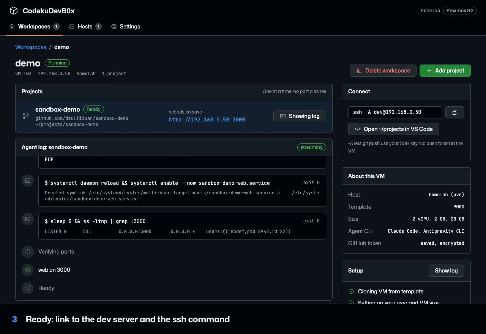
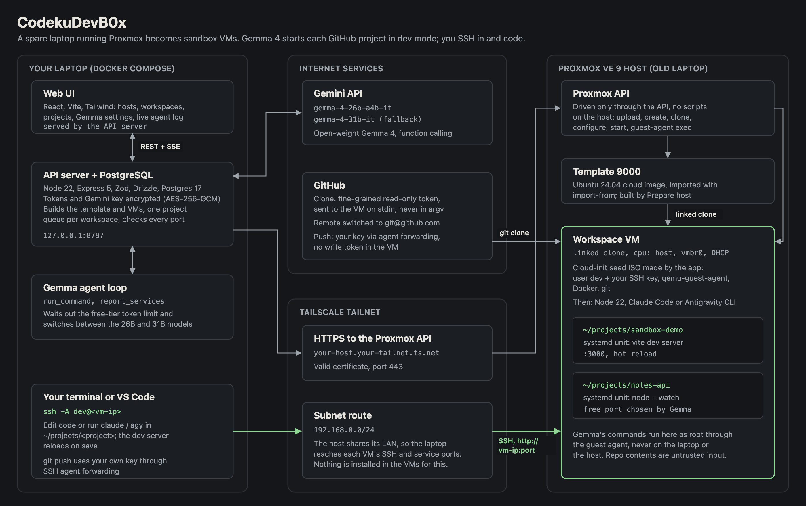

# CodekuDevB0x

Turn an old laptop running Proxmox into on-demand sandbox VMs for working on GitHub projects. You pick a repo, the app boots an Ubuntu VM, and a Gemma 4 agent reads the repo and starts its services in dev mode on free ports. You SSH in, edit code or run `claude`, and the dev server reloads.

Built at Hacktoberfest Hack Day Kota Batam (MLH), 31 Oct 2026. Entered in "Best Use of Gemma 4" and "Best Open-Source AI Project".

## Demo

[](docs/demo.mp4)

[Watch the 90-second demo video](docs/demo.mp4). It is one real run on a home Proxmox VE 9.2 server: add the host, create a workspace, Gemma 4 sets up a Vite repo, and an edit made over SSH shows up in the browser. Waiting is sped up and marked.

## How it works



Nothing runs on the Proxmox host except through its API.

1. **Prepare host.** The app builds an Ubuntu 24.04 template VM from the official cloud image, using only API calls (download the image, create the VM, convert it to a template).
2. **Create a workspace.** The app clones the template, generates a cloud-init seed ISO (user `dev`, your SSH public key, qemu-guest-agent, Docker, git), uploads it, resizes the disk and boots the VM. VMs get their IP from DHCP.
3. **Install tools.** Through the guest agent it waits for cloud-init, installs Node.js 22, and installs the agent CLIs you picked (Claude Code, Antigravity CLI).
4. **Add a project.** The repo is cloned to `/home/dev/projects/<name>`. If you gave a GitHub token, it is passed on stdin and the remote is switched to SSH after cloning.
5. **Gemma sets it up.** Gemma 4 (`gemma-4-26b-a4b-it` via the Gemini API, with function calling) reads the repo with `run_command`, installs what it needs, starts each service as a systemd unit in dev/watch mode on `0.0.0.0`, avoiding ports other projects in the VM already use, and calls `report_services`.
6. **Verify.** The server TCP-connects to each reported port for up to 60 s. If one fails, Gemma gets one more round with the error.
7. **Work.** The UI shows `http://<vm-ip>:<port>` links and `ssh -A dev@<vm-ip>`. `git push` uses your own key through SSH agent forwarding, so no write token goes into the VM.

```
 Laptop                              Proxmox host                  Workspace VM (Ubuntu 24.04)
 +-------------------+   HTTPS API   +-----------------+  clone,  +-----------------------------+
 | web UI (Vite)     |-------------->| Proxmox API     |  guest-  | cloud-init: dev, Docker,    |
 | server (Express)  |               | /api2/json      |  agent   |   git, qemu-guest-agent     |
 |   PostgreSQL      |               |                 |--------->| /home/dev/projects/<repo>   |
 +-------------------+               +-----------------+  exec    |   systemd dev servers       |
   |        |                                                     +-----------------------------+
   |        +-- Gemini API (Gemma 4, function calling)                    ^
   +------------- ssh -A dev@<vm-ip>, http://<vm-ip>:<port> --------------+
```

Projects in one workspace are set up one at a time, so Gemma always knows which ports are taken.

## Requirements

- A Proxmox VE host with local storage that can hold `import` and `iso` content (the app enables both on `local` if missing) and a bridge (default `vmbr0`) on a network with DHCP.
- Network access from the machine running the app to the Proxmox API and to the VM IPs. In the demo, the Proxmox host shares its LAN subnet over Tailscale and the laptop has "Use Tailscale subnets" on.
- Docker with Compose (runs PostgreSQL, and the whole app for a full deploy). Node.js 22 or newer and npm for development.
- A Gemini API key, added on the Settings page after the first start.
- On macOS the seed ISO is built with `hdiutil`. Elsewhere it needs `genisoimage` (included in the Docker image).

## Setup

### 1. Proxmox API token

In the Proxmox UI, under Datacenter > Permissions:

1. Create a user (or use an existing one) and add a **User Permission** on path `/` with the role `Administrator`.
2. Create an API token for that user under API Tokens.
3. Add an **API Token Permission** on path `/` with the role `Administrator` for that token.

With privilege separation on, the token's effective rights are the intersection of the user's and the token's permissions, so both are needed.

### 2. Environment

```sh
cp .env.example .env
```

Fill in `APP_SECRET` (`openssl rand -base64 32`). `DATABASE_URL`, `PORT` and `HOST` have working defaults for local development. The `E2E_*` variables are only for the E2E test.

The Gemini API key is not read from `.env`. After the first start, open **Settings**, paste the key, test it and save. The models default to `gemma-4-26b-a4b-it` with `gemma-4-31b-it` as fallback and can be changed there.

### 3. Run

Full deploy (PostgreSQL and the app, one command):

```sh
docker compose up -d --build
```

Open http://localhost:8787. Compose publishes the app on `127.0.0.1` only, waits for the database health check before starting the app, and keeps the data in the `postgres-data` volume.

Development (PostgreSQL in Docker, app with hot reload):

```sh
docker compose up -d db
npm install
npm --prefix server install
npm --prefix web install
npm --prefix server run dev
npm --prefix web run dev
```

The database listens on `127.0.0.1:5433`, which matches `DATABASE_URL` in `.env.example`. The server creates its tables on startup and listens on port 8787. The Vite dev server proxies `/api` to it; open the URL Vite prints.

## Using it

1. **Hosts > Add host.** Enter the API URL, token ID (`user@realm!token`) and secret. Node, template VM ID (9000) and bridge (`vmbr0`) have defaults. The app checks the connection before saving.
2. **Prepare host.** Builds template VM 9000. The host card shows progress and turns to "ready" when done.
3. **New workspace.** Pick the host, paste your SSH public key, optionally a GitHub token (needed for private repos), choose agent CLIs and VM size, and optionally a first repo.
4. **Add project.** Paste a `https://github.com/owner/repo` URL. The workspace page streams Gemma's messages and every command it runs, then lists the service links.
5. **SSH in.** Copy `ssh -A dev@<vm-ip>` from the Connect box (or use the VS Code Remote-SSH link), `cd ~/projects/<name>`, edit files or run `claude`, and watch the dev server reload. `git push` goes over SSH with your forwarded key.

### No template yet?

Workspaces are cloned from an Ubuntu 24.04 template VM (ID 9000 by default) that has no Proxmox cloud-init drive. **Prepare host** builds it for you. If the host's download from cloud-images.ubuntu.com is slow or blocked, upload the image yourself or create the template in the Proxmox shell. [docs/template-guide.md](docs/template-guide.md) covers all three options.

## E2E test

The only test runs against a real Proxmox host. Start the server, fill in the `E2E_*` variables in `.env`, then:

```sh
npm run e2e
```

It adds the host, prepares the template if needed, creates a workspace with `E2E_REPO_URL` as its first project, waits for the project to be ready, checks the service URLs respond, appends a marker to a served file inside the VM and waits up to 30 s for it to show up over HTTP (hot-reload proof), then deletes the workspace and the host. Results go to `e2e-report.json`, including each step's timing and the hot-reload marker and delay.

Demo repos used: `dzulfiikar/sandbox-demo` (Vite) and `dzulfiikar/notes-api` (Express). Both are private and both default to port 3000, so adding both to one workspace shows Gemma picking a free port for the second.

Other checks: `npm run typecheck`, `npm run lint`, and `npm --prefix server run smoke:gemma` (one Gemma function-calling request with the key and model saved on the Settings page).

## Security notes

- Proxmox token secrets and GitHub tokens are encrypted at rest with AES-256-GCM using `APP_SECRET`. They are never returned by the API or written to events.
- The GitHub token reaches the VM only through guest-agent stdin, never in a command line, and the repo remote is switched to SSH after cloning.
- Gemma's commands run only inside the workspace VM, as root, through the guest agent. They never run on the Proxmox host or on your machine.
- Repo contents are untrusted input to the model. A malicious repo can steer what Gemma runs inside the VM.
- Workspace VMs have internet access.
- The app has no login. The server listens on `127.0.0.1` by default (`HOST` overrides it), and Docker Compose publishes the port on `127.0.0.1` only. Don't expose port 8787 to other machines.
- The Proxmox token has Administrator rights. Use a dedicated host or test node.

## Limits

- Tested on one Proxmox host.
- The UI is built for desktop screens only.
- Projects in a workspace are set up one at a time.
- No authentication in the app itself.
- Workspace VMs use `cpu: host`. Claude Code's installer and Vite's native build tools crash with "Illegal instruction" on Proxmox's default `x86-64-v2-AES` CPU type, so live migration between different CPUs is not supported.
- On the Gemini API free tier, Gemma 4 allows 16,000 input tokens per minute per model. The agent waits when it hits that limit and switches between `gemma-4-26b-a4b-it` and `gemma-4-31b-it`, so setup can pause for a minute on larger repos.

## How AI was used to build this

- **At runtime:** Gemma 4 (`gemma-4-26b-a4b-it`, falling back to `gemma-4-31b-it`) through the Gemini API is the agent that sets up each project inside the VM.
- **To build it:** the code, docs and design were written during the Hack Day with Claude Code (Claude Opus 5.5) working as a team of agents (planning, server, web, docs), with the author directing, reviewing and testing against a real Proxmox host. The UI was designed first in pen.dev.

## License

MIT. See [LICENSE](LICENSE).
